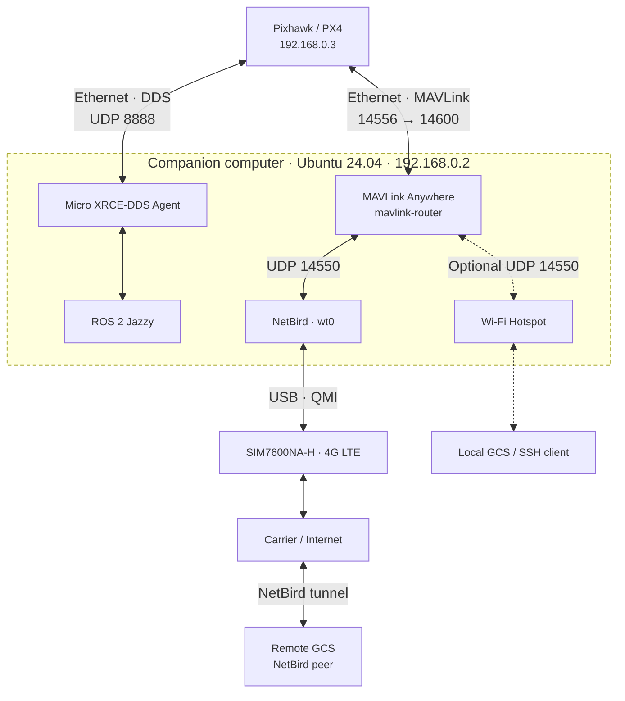

# Companion Computer Setup — Ubuntu 24.04 LTS

Ubuntu 24.04 companion computer setup for PX4: Ethernet, MAVLink Anywhere, ROS 2 Jazzy, Micro XRCE-DDS, optional 4G LTE and NetBird.

## Hardware examples

### Companion computers

<table>
  <tr>
    <td align="center" width="33%">
      
    </td>
    <td align="center" width="33%">
      
    </td>
    <td align="center" width="33%">
      
    </td>
  </tr>
  <tr>
    <td align="center"><strong>Orange Pi 6</strong> ARM64 edge computing RM520N-GL ECM bench-tested <a href="https://orangepi.vn/shop/orange-pi-6-phien-ban-8gb-ram">Photo / product</a></td>
    <td align="center"><strong>Raspberry Pi 5</strong> ARM64 companion computer PX4 Ethernet bench-tested <a href="https://www.raspberrypi.com/products/raspberry-pi-5/">Official product</a> · <a href="https://geekworm.com/products/raspberry-pi-5-board">Photo</a></td>
    <td align="center"><strong>Jetson Orin Nano Super</strong> GPU-accelerated edge computing Reference only; not validated <a href="https://marketplace.nvidia.com/en-us/enterprise/robotics-edge/jetson-orin-nano-super-developer-kit/">Photo / product</a></td>
  </tr>
</table>

Use the correct board image/BSP. Jetson requires compatible JetPack/L4T; it is a reference platform, not a validated target.

### 4G LTE modem

 <strong>SIM7600NA-H</strong> · LTE Cat 4 · USB QMI

Use a compatible USB adapter, data SIM, power and antennas. [SIMCom product information](https://www.simcom.com/product/SIM7600X-H.html). Photo credits: linked suppliers.

## System architecture

MAVLink and XRCE-DDS share one dedicated Ethernet link but use separate UDP ports. Remote GCS traffic follows the optional cellular/NetBird path; local GCS requires a configured router endpoint.

ModemManager manages QMI; NetworkManager starts the optional Hotspot (192.168.50.1/24).

## Setup

| Step | Guide |
|---|---|
| 01 | [Ubuntu 24.04](docs/01_UBUNTU_24_04.md) |
| 02 | [PX4 Ethernet](docs/02_PX4_ETHERNET.md) |
| 03 | [MAVLink Anywhere](docs/03_MAVLINK.md) |
| 04 | [ROS 2 Jazzy and DDS](docs/04_ROS2_DDS.md) |
| 05 | [SIM7600NA-H 4G and Wi-Fi](docs/05_SIM7600.md) |
| 06 | [NetBird and remote access](docs/06_REMOTE_ACCESS.md) |
| 07 | [Network quality](docs/NETWORK_QUALITY.md) |
| 08 | [Validation checklist](docs/VALIDATION.md) |

## Quick start

Clone this branch on Ubuntu 24.04. The installer configures **4G QMI networking only**; follow steps 01–04 for PX4 middleware.

~~~bash
sudo apt install -y git
git clone -b setup/sim7600na-h-qmi-hotspot --single-branch https://github.com/bluemoonfake/Companion-computer-setup-guide.git
cd Companion-computer-setup-guide
sudo ./config --check
sudo ./config
~~~

Run from a local console; switching Wi-Fi can disconnect SSH. Select the GSM profile and optional auto-start Hotspot.

~~~bash
sudo ./config --status
sudo ./config --logs
~~~

## Quality test

Run on the bench, not during flight.

~~~bash
./quality --self-test
sudo ./quality --mode cellular --deep
~~~

For RF, NetBird and TCP/UDP load tests see [Network Quality](docs/NETWORK_QUALITY.md).

## Update

~~~bash
git pull --ff-only
./config --version
./quality --version
~~~

No installer rerun is needed for documentation or quality updates. No RM520N watchdog is installed on this QMI branch.

[Changelog](CHANGELOG.md) · [Validation status](docs/VALIDATION.md)
