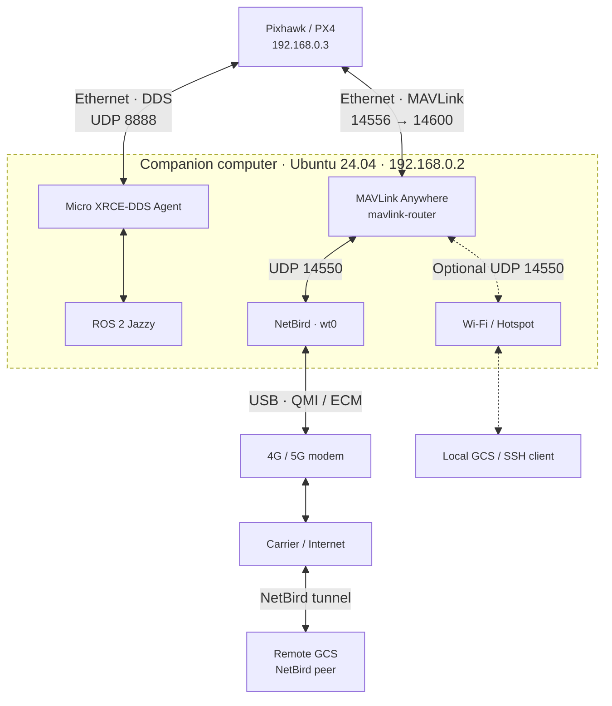

# Companion Computer Setup — Ubuntu 24.04 LTS

Ubuntu 24.04 companion computer setup for PX4: Ethernet, MAVLink Anywhere, ROS 2 Jazzy, Micro XRCE-DDS, optional 4G/5G and NetBird.

## Hardware examples

### Companion computers

<table>
  <tr>
    <td align="center" width="33%">
      
    </td>
    <td align="center" width="33%">
      
    </td>
    <td align="center" width="33%">
      
    </td>
  </tr>
  <tr>
    <td align="center"><strong>Orange Pi 6</strong> ARM64 edge computing RM520N-GL ECM bench-tested <a href="https://orangepi.vn/shop/orange-pi-6-phien-ban-8gb-ram">Photo / product</a></td>
    <td align="center"><strong>Raspberry Pi 5</strong> ARM64 companion computer PX4 Ethernet bench-tested <a href="https://www.raspberrypi.com/products/raspberry-pi-5/">Official product</a> · <a href="https://geekworm.com/products/raspberry-pi-5-board">Photo</a></td>
    <td align="center"><strong>Jetson Orin Nano Super</strong> GPU-accelerated edge computing Reference only; not validated <a href="https://marketplace.nvidia.com/en-us/enterprise/robotics-edge/jetson-orin-nano-super-developer-kit/">Photo / product</a></td>
  </tr>
</table>

Use the correct board image/BSP. Jetson requires compatible JetPack/L4T; it is a reference platform, not a validated target.

### Cellular modules

<table>
  <tr>
    <td align="center" width="33%"></td>
    <td align="center" width="33%"></td>
    <td align="center" width="33%"></td>
  </tr>
  <tr>
    <td align="center"><strong>RM520N-GL</strong> 5G NR / ECM <a href="https://github.com/bluemoonfake/Companion-computer-setup-guide/tree/setup/RM520N-GL">Setup branch</a></td>
    <td align="center"><strong>SIM7600G-H</strong> 4G LTE / QMI <a href="https://github.com/bluemoonfake/Companion-computer-setup-guide/tree/setup/sim7600g-h-qmi-hotspot">Setup branch</a></td>
    <td align="center"><strong>SIM7600NA-H</strong> 4G LTE / QMI <a href="https://github.com/bluemoonfake/Companion-computer-setup-guide/tree/setup/sim7600na-h-qmi-hotspot">Setup branch</a></td>
  </tr>
</table>

Photo credits: Orange Pi Vietnam, Geekworm, NVIDIA, Waveshare, Spotpear and RobotShop (linked originals). Use the correct USB adapter, SIM, power and antennas.

## System architecture

MAVLink and XRCE-DDS share one dedicated Ethernet link but use separate UDP ports. Remote GCS traffic follows the optional cellular/NetBird path; local GCS requires a configured router endpoint.

Select the modem branch for its USB mode and Wi-Fi policy.

## Setup

| Step | Guide |
|---|---|
| 01 | [Ubuntu 24.04](docs/01_UBUNTU_24_04.md) |
| 02 | [PX4 Ethernet](docs/02_PX4_ETHERNET.md) |
| 03 | [MAVLink Anywhere](docs/03_MAVLINK.md) |
| 04 | [ROS 2 Jazzy and DDS](docs/04_ROS2_DDS.md) |
| 05 | [Choose cellular module](docs/05_CELLULAR.md) |
| 06 | [NetBird and remote access](docs/06_REMOTE_ACCESS.md) |
| 07 | [Network quality](docs/NETWORK_QUALITY.md) |
| 08 | [Validation checklist](docs/VALIDATION.md) |

## Quick start

Choose the branch for your modem; all share steps 01–04 and 06. Without cellular, use main and follow the common guides.

| Module | Branch | Mode |
|---|---|---|
| RM520N-GL | [setup/RM520N-GL](https://github.com/bluemoonfake/Companion-computer-setup-guide/tree/setup/RM520N-GL) | 5G NR / ECM |
| SIM7600G-H | [setup/sim7600g-h-qmi-hotspot](https://github.com/bluemoonfake/Companion-computer-setup-guide/tree/setup/sim7600g-h-qmi-hotspot) | 4G LTE / QMI |
| SIM7600NA-H | [setup/sim7600na-h-qmi-hotspot](https://github.com/bluemoonfake/Companion-computer-setup-guide/tree/setup/sim7600na-h-qmi-hotspot) | 4G LTE / QMI |

~~~bash
sudo apt install -y git
git clone https://github.com/bluemoonfake/Companion-computer-setup-guide.git
cd Companion-computer-setup-guide
~~~

For cellular setup, switch to the correct branch (example RM520N-GL). Use local console access.

~~~bash
git switch setup/RM520N-GL
sudo ./config --check
sudo ./config
~~~

The installer is modem-specific, not a full OS installer. The SIM7600 branches use ModemManager/QMI, not the RM520N ECM watchdog.

## Quality test (modem branch)

~~~bash
./quality --self-test
sudo ./quality --mode cellular --deep
~~~

Run on the bench only. For optional RF and load testing, follow the selected branch's Network Quality guide.

~~~bash
git pull --ff-only
~~~

[Changelog](CHANGELOG.md) · [Validation](docs/VALIDATION.md)
